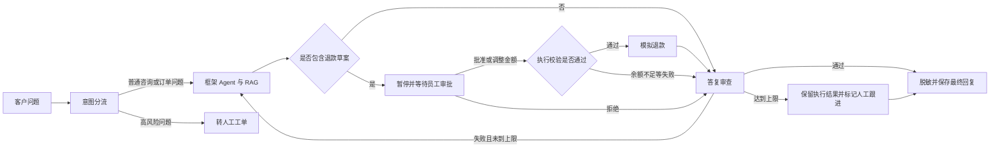

# 售后智控：电商售后 Agent

一个可本地运行的电商售后项目。它使用 LangGraph 编排多节点工作流，通过
DeepSeek 选择工具和生成答复，使用 Chroma 与混合重排检索政策，
并把退款执行放在人工审批之后。

项目同时提供 Streamlit 双角色界面和 FastAPI 接口。业务数据、工作流检查点、
向量知识库分别持久化，方便演示一次售后请求从输入到审批、审查和最终答复的
完整过程。

## 核心能力

- 多节点工作流：意图分流、工具处理、人工审批、答复审查、最终响应。
- 框架 Agent：solver 使用 LangChain `create_agent` 管理模型与工具往返，外层 LangGraph 管理业务阶段。
- 按调用选择输出模式：分流、审查和评测使用 JSON 模式与 Pydantic 校验；处理节点保留工具调用和自然语言回复。
- 按节点配置思考：依据节点实测默认全部关闭，复杂流程可手动开启 solver；保留并回传思考模式工具往返中的 reasoning_content。
- 用量统计：按节点、模式记录输入、输出、推理子项、缓存读取 Token 与耗时，不保存思考正文。
- 工具调用：查询当前客户订单、物流、政策，创建退款草案和 CRM 备注。
- RAG：BGE 向量召回 8 条候选，融合向量相似度与 BM25 风格词项分数后保留前 3 条。
- 人工介入：退款草案通过 LangGraph `interrupt()` 暂停，员工决定后恢复。
- 业务安全：订单归属校验、整数分累计校验、员工接口令牌和按退款申请编号防重。
- 部分退款：同一订单可多次退款，累计不超过实付；员工可调整批准金额并保留审计记录。
- 状态持久化：SQLite 保存业务数据，独立检查点保存会话和暂停进度。
- 可追踪与评测：操作日志、30 条评测场景、确定性安全检查和模型辅助评分。
- 双入口：Streamlit 客户/员工界面，以及 FastAPI HTTP 服务和交互文档。

## 处理流程



## 技术栈

Python 3.11、LangGraph、LangChain、DeepSeek、Chroma、
Sentence Transformers、FastAPI、Streamlit、SQLite。

## 快速启动

在 `ecommerce-after-sales-agent` 项目根目录中运行。目录改名不影响已有 Conda 环境；
已有环境可直接激活并安装依赖，以下创建环境的命令只需首次安装时执行：

```powershell
conda create -n ecommerce-after-sales-agent python=3.11 -y
conda activate ecommerce-after-sales-agent
python -m pip install -r requirements.txt
```

已有项目环境升级后也需运行安装依赖命令，补装 `langchain==1.4.7`。

创建本地配置：

```powershell
Copy-Item .env.example .env
```

在 `.env` 中填写 `DEEPSEEK_API_KEY`。员工 API 默认关闭；如需使用，先生成随机
令牌，再填写到 `STAFF_API_TOKEN`：

```powershell
python -c "import secrets; print(secrets.token_urlsafe(32))"
```

首次初始化演示数据和政策索引：

```powershell
$env:HF_HOME = "$PWD\.cache\huggingface"
$env:TORCH_HOME = "$PWD\.cache\torch"
python -m ecommerce_after_sales_agent.seed
```

启动网页界面：

```powershell
python -m streamlit run app.py
```

选择客户“林晓”，输入：

> 我的订单 ORD-5001 一直没收到，顺丰确认丢件了，我想申请退款。

随后切换到员工工作台批准或拒绝，再回客户视图查看结果。

部分退款可输入“订单 ORD-5001 先申请退 100 元”，员工工作台可确认或调整金额。
再次申请按当前剩余可退金额校验。草案不预占余额，批准执行时会重新核对，余额不足则记录失败。

升级前已有业务数据时，启动程序会自动备份并迁移旧退款表，不清空订单和退款。
只更新政策索引可运行下面的命令；已有数据请勿重新执行不带参数的初始化命令：

```powershell
python -m ecommerce_after_sales_agent.seed --index-only
```

## FastAPI 服务

启动接口：

```powershell
python -m uvicorn api:app --host 127.0.0.1 --port 8000
```

打开 `http://127.0.0.1:8000/docs` 可查看交互式接口文档。主要接口包括：

- `POST /api/v1/chat`：提交客户咨询。
- `GET /api/v1/threads/{thread_id}`：查询客户自己的处理结果。
- `GET /api/v1/staff/approvals`：读取待审批列表。
- `POST /api/v1/staff/approvals/{id}/decision`：提交员工决定。

员工接口通过 `X-Staff-Token` 请求头校验。当前客户接口使用演示 `customer_id`
识别身份，尚未接入真实登录系统。

审批请求可使用 `{"approved": true, "staff_id": "staff-demo", "amount": 50}` 调整本次金额，
省略 `amount` 则使用申请金额。最终状态可能为 `approved`、`rejected` 或执行校验失败的 `failed`。
接口和工作台均保留原申请金额与实际批准金额，详细设计见 [部分退款与审批](docs/部分退款与审批.md)。

## 演示数据

| 客户 | 订单 | 商品 | 实付金额 | 物流状态 |
| --- | --- | --- | ---: | --- |
| 林晓 | ORD-5001 | 无线头戴耳机 | ¥299.00 | 顺丰确认丢件 |
| 张伟 | ORD-5002 | 机械键盘 | ¥199.00 | 中通已签收 |
| 王芳 | ORD-5003 | USB-C 数据线两条装 | ¥29.90 | 圆通运输中 |
| 李明 | ORD-5004 | 降噪耳塞 | ¥399.00 | 京东物流已签收 |
| 陈静 | ORD-5005 | 升降办公桌 | ¥1299.00 | 成都仓备货 |

所有客户、运单、支付和退款均为演示数据，不涉及真实订单或资金。

## 测试与评测

运行离线测试，不调用真实模型：

```powershell
python -m unittest discover -s tests -v
```

当前测试覆盖金额格式与政策、检索与重排、审批批准与拒绝、跨客户订单访问、
退款金额校验、重复退款保护和员工 API 鉴权，以及结构化字段、严格布尔值、失败分支和输出模式隔离。
另含部分退款累计、请求幂等、并发防超额、旧表备份迁移、审批金额调整和检查点恢复测试。
当前共 66 项离线测试；其中模型和 HTTP 传输测试使用本地替身。
离线测试验证程序行为与请求协议，不代表真实模型的业务准确率。

| 测试范围 | 用例数 |
| --- | ---: |
| 部分退款、审批调整、幂等、并发与迁移 | 26 |
| 订单归属、退款执行与员工接口鉴权 | 4 |
| 展示、政策检索与审批流程 | 5 |
| 结构化输出与调用模式隔离 | 9 |
| 思考模式与 Token 统计 | 9 |
| 实验报告与中断恢复 | 3 |
| 框架 Agent 权限、预算、上下文与模型协议 | 10 |
| **合计** | **66** |

以上为 2026-11-01 离线运行通过的用例数量。下面的 30 条模型评测场景是独立数据集，
不计入这 66 项，也不能直接作为模型测试通过数量。

模型输出模式及其边界见 [结构化输出与调用模式](docs/结构化输出与调用模式.md)。
思考模式配置、Token 统计与真实接口小检查见 [思考模式与用量验证](docs/思考模式与用量验证.md)。
内外层工作流、工具中间件和调用预算见 [框架 Agent 与业务工作流](docs/框架Agent与业务工作流.md)。

小规模真实评测：

```powershell
python eval.py --limit 3
```

完整评测会调用真实模型并产生费用。`ecommerce_after_sales_agent/eval_dataset.py` 中的 30 条
数据是预期标签，只有实际运行生成 `EVAL_RESULTS.md` 后才能报告本次成绩。

## 项目结构

```text
ecommerce-after-sales-agent/
├── ecommerce_after_sales_agent/
│   ├── __init__.py       # 包初始化与模型缓存配置
│   ├── config.py         # 模型、路径与服务配置
│   ├── graph.py          # 工作流、状态、中断与恢复
│   ├── solver_agent.py   # create_agent、工具权限与调用预算
│   ├── tools.py          # 业务工具、权限校验、退款幂等
│   ├── rag.py            # 向量召回和重排
│   ├── kb_docs.py        # 售后政策知识库
│   ├── llm.py            # 模型工厂与结构化调用
│   ├── schemas.py        # 模型输出契约
│   ├── usage.py          # Token 与耗时统计
│   ├── i18n.py           # 状态名称与金额显示
│   ├── db.py             # SQLite 表结构和数据访问
│   ├── money.py          # 金额校验与整数分转换
│   ├── seed.py           # 演示数据初始化
│   └── eval_dataset.py   # 30 条评测场景
├── docs/                 # 架构图与技术说明
├── tests/                # 离线回归测试
├── api.py                # FastAPI 服务
├── app.py                # Streamlit 客户与员工界面
├── check_model.py        # 模型连接与工具调用检查
├── eval.py               # 评测与报告生成
├── benchmark_thinking.py # 隔离业务数据的节点思考模式实验
├── .env.example          # 本地配置模板
├── pyproject.toml        # 项目元数据与依赖
└── requirements.txt      # 依赖安装清单
```

`ecommerce-after-sales-agent` 是项目文件夹与包管理名称；`ecommerce_after_sales_agent` 是源码中的
Python 包名，对应 `python -m ecommerce_after_sales_agent.seed` 和程序中的导入路径。

## 当前边界

- 退款、物流、CRM 和发送动作均为本地模拟。
- 检索使用 `BAAI/bge-small-zh-v1.5` 索引政策，候选内容融合 BGE 余弦相似度与
  单字、双字词项的 BM25 风格分数重排；未使用独立 CrossEncoder 模型。
- 当前 API 适合本地单机演示；生产环境还需要真实登录、角色权限、限流、监控、
  完整迁移管理和外部支付/物流接口。业务库与检查点之间尚无跨库原子提交，异常中断仍需核对。
- 模型审查用于降低无依据回复风险，不能保证完全消除错误，重要售后仍需人工处理。

