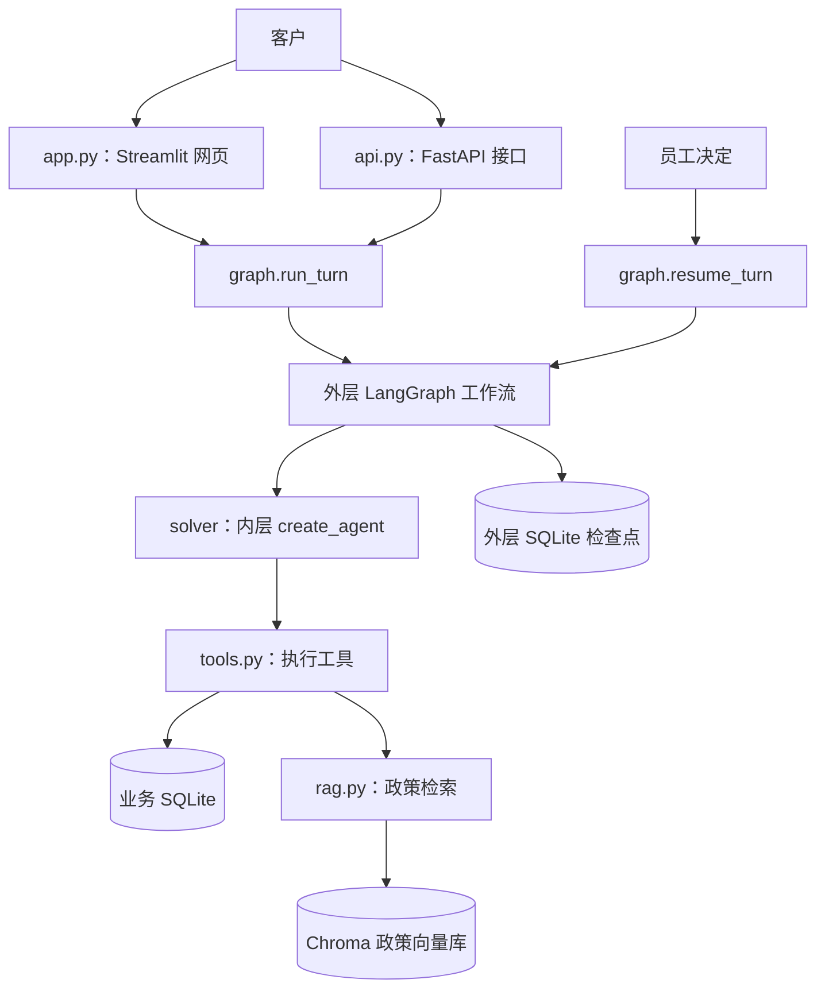
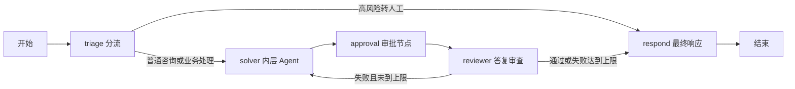

# 电商售后项目总览与完整运行链路

更新日期：2026-11-05。本文按当前“框架 Agent + 部分退款”版本说明，早期手写工具循环不再是当前实现。文中订单、客户、金额和返回值均为演示例子。

阅读顺序：先看第 1～3 节建立地图，再看第 4 节跟踪完整请求，最后按需查文件表、数据表和源码位置。

## 1. 这个项目解决什么问题

客户可以咨询售后政策、查询订单和物流、申请退款。系统结合模型、业务工具和政策知识库形成答复；涉及退款时，先提出方案，等待员工审批，批准后才记录模拟退款。

可以把它分成四层：

| 层次 | 在项目中的实现 | 负责什么 |
| --- | --- | --- |
| 交互入口 | `app.py`、`api.py` | 接收客户问题、展示结果、接收员工决定 |
| 业务流程 | `graph.py` | 决定先分流、再处理、何时暂停、何时审查和回复 |
| Agent 与能力 | `solver_agent.py`、`tools.py`、`rag.py`、`llm.py` | 让模型选择工具，执行查询，查政策，形成草稿 |
| 数据与规则 | `db.py`、`money.py`、`kb_docs.py`、检查点 | 保存订单、审批和退款，校验金额，提供政策和恢复进度 |

其中，**模型负责提出工具调用和生成文字，Python 执行工具与校验，数据库保存结果**。模型输出一句“已退款”本身不会让数据库产生退款记录。

订单、物流、支付、CRM 和发送动作均是演示实现，没有对接真实电商平台或支付系统。模型 API 和政策向量检索则有实际接入代码。

## 2. 项目目录地图

下面同时列出源码与默认运行数据位置。`data/`、`.cache/`、`.env` 等属于本地配置或运行产物，并非首次下载源码就一定全部存在。

```text
ecommerce-after-sales-agent/
├── app.py                         # Streamlit 网页：客户和员工两个视图
├── api.py                         # FastAPI：客户咨询、结果查询、员工审批接口
├── check_model.py                 # 模型普通调用和工具调用的连接检查
├── eval.py                        # 业务场景评测、模型评分、生成评测报告
├── benchmark_thinking.py          # 分节点比较思考开关的实验脚本
│
├── ecommerce_after_sales_agent/   # 核心 Python 包，主要业务代码在这里
│   ├── __init__.py                # 包初始化、Hugging Face 匿名下载行为
│   ├── config.py                  # 模型、思考开关、数据路径、追踪与接口配置
│   ├── graph.py                   # 外层业务工作流、状态、人工中断和恢复
│   ├── solver_agent.py            # 内层 create_agent、权限和调用预算中间件
│   ├── tools.py                   # 订单、物流、政策、草案等工具；模拟退款执行
│   ├── rag.py                     # 政策切块、向量索引、召回和混合重排
│   ├── kb_docs.py                 # 政策原文、来源编号和政策版本
│   ├── llm.py                     # 模型工厂、结构化输出、思考字段兼容
│   ├── schemas.py                 # 分流、审查、评测的 Pydantic 输出契约
│   ├── db.py                      # 业务表结构、迁移、审批、余额和日志读写
│   ├── money.py                   # 金额校验，元与整数分转换
│   ├── usage.py                   # Token、缓存读取、推理子项和耗时统计
│   ├── i18n.py                    # 状态名称、工具名称和金额的显示辅助函数
│   ├── seed.py                    # 演示业务数据和政策索引初始化
│   └── eval_dataset.py            # 30 条模型业务评测场景及预期标签
│
├── tests/                        # 离线测试，不是网页启动时执行的业务流程
│   ├── test_chinese_flow.py
│   ├── test_security_and_api.py
│   ├── test_structured_output.py
│   ├── test_thinking_and_usage.py
│   ├── test_benchmark_recovery.py
│   ├── test_partial_refunds.py
│   └── test_framework_agent.py
│
├── docs/                         # 总览、设计说明和外层工作流图
│   ├── 项目总览与完整运行链路.md  # 本文
│   ├── 框架Agent与业务工作流.md
│   ├── 部分退款与审批.md
│   ├── 结构化输出与调用模式.md
│   ├── 思考模式与用量验证.md
│   ├── langgraph.mmd              # 外层图的 Mermaid 源文件
│   └── langgraph.png              # 外层图图片
│
├── data/                         # 程序默认持久化位置
│   └── cn/                       # 现有数据标识；不随代码包改名自动变化
│       ├── after_sales_agent.db   # SQLite 业务库
│       ├── checkpoints.sqlite    # LangGraph 外层检查点
│       └── chroma/               # Chroma 管理的政策向量库
├── .cache/                       # 本地缓存、验证日志等
├── .env                          # 本地密钥与配置，不上传
├── .env.example                  # 配置字段模板，不含实际密钥
├── .gitignore                    # 排除密钥、运行数据和缓存等文件
├── .git/                         # Git 本地版本管理元数据，不参与业务运行
├── .idea/                        # IDE 本地配置，不参与业务运行
├── requirements.txt              # pip 依赖安装清单
├── pyproject.toml                # 项目名称、版本、Python 要求与依赖
├── README.md                     # 对外项目说明与快速启动
├── DEEPSEEK_SETUP.md              # 模型接口接入说明
└── LICENSE                       # 现有许可文本
```

外层目录名 `ecommerce-after-sales-agent` 与内层包名 `ecommerce_after_sales_agent` 是两个概念。Python 命令使用包名，例如 `python -m ecommerce_after_sales_agent.seed`；数据文件仍沿用 `after_sales_agent.db`，不是漏改包名。

## 3. 两个入口、两层图、三类持久化

### 3.1 两个入口调用相同业务代码



Streamlit 直接调用 `graph.run_turn`，当前没有先发送 HTTP 请求给 FastAPI。FastAPI 是另一种可独立使用的入口。演示网页只需启动 Streamlit；只有需要 HTTP 接口时才另外启动 FastAPI。

### 3.2 外层控制业务，内层处理模型和工具

外层由 `graph.py:build_graph` 定义：



是否回环由 `_route_after_review` 判断。审查通过或失败达到上限都会进入 `respond`，由它生成最终结果。`approval` 节点总会被正常处理路线经过；只有存在敏感操作方案时才在该节点内部暂停。

内层位于 `solver_agent.py`：

```text
create_agent
  → 调用模型
  → 模型要求工具？
      → 是：执行工具，追加 ToolMessage，再调用模型
      → 否：取得答复草稿，结束内层处理
  → 将本次消息交回 graph.solver_node 整理
```

当前没有项目手写的 `for ... model.invoke(...)` 工具执行循环。`solver_node` 里仍遍历消息，是为了提取工具结果、政策来源和退款草案。

### 3.3 三类持久化分别负责什么

| 保存位置 | 保存内容 | 主要代码 | 不能替代什么 |
| --- | --- | --- | --- |
| `data/cn/after_sales_agent.db` | 客户、订单、审批、退款、日志、最终答复 | `db.py`、`tools.py` | 单独一条 pending 审批不能恢复完整工作流 |
| `data/cn/checkpoints.sqlite` | 外层工作流状态和暂停恢复信息 | `graph.get_checkpointer`、`SqliteSaver` | 不替代订单和退款业务账本 |
| `data/cn/chroma/` | 政策文本块、向量及元数据 | `rag.py` | 不保存客户订单和退款流水 |

内层 `create_agent(checkpointer=False)` 不单独保存内部模型调用进度。外层检查点负责会话和人工暂停；进程若在内层执行中退出，不能精确从某一次内部模型调用接着跑。

## 4. 从启动到完成一笔退款，逐步追踪

本节假设：客户 `CUST-1001` 的订单 `ORD-5001` 实付 299 元、物流状态为 `lost`，此前未退款。客户提出：

> 订单 ORD-5001 没收到，承运商确认丢件，我想先申请退 100 元。

以下是符合项目规则的一种运行示意。模型决定具体调用哪些工具、调用几次，实际次序和文字可能变化；项目没有硬编码“每个问题固定查四个工具”。

### 第 0 步：启动程序，准备业务表和外层图

以网页入口为例，启动 `app.py` 后：

```text
app.py:get_app
  → db.init_db()                 创建业务表，必要时兼容迁移旧退款表
  → graph.get_app()
      → graph.get_checkpointer() 创建 SqliteSaver
      → graph.build_graph(cp)    定义五个业务节点和连线
          → g.compile(checkpointer=cp)
```

`get_app()` 返回的是编译后的业务工作流。一次创建中，传给 `build_graph` 和 `compile` 的检查点参数是同一个对象引用。

Streamlit 用 `st.cache_resource` 复用该工作流；网页交互导致脚本重运行时，不必每次重新创建。启动只负责准备表，不自动填入演示订单，也不自动重建政策索引。

### 第 1 步：网页收集输入，调用 run_turn

入口在 [app.py:render_customer](../app.py#L132)，其中的真实调用为：

```python
res = graph.run_turn(prompt, customer_id, st.session_state.thread_id, app=app)
```

这次调用可以理解为：

```python
graph.run_turn(
    "订单 ORD-5001 没收到，承运商确认丢件，我想先申请退 100 元。",
    "CUST-1001",
    "demo-thread-001",
    app=app,
)
```

| 标识 | 本例 | 意义 |
| --- | --- | --- |
| `query` | 客户的一句话 | 这次需要处理的问题 |
| `customer_id` | `CUST-1001` | 当前客户，供订单归属检查使用 |
| `thread_id` | `demo-thread-001` | 外层会话/工作流恢复标识 |
| `order_id` | `ORD-5001` | 要操作的订单 |
| `request_id` | 稍后生成的 `DRAFT-...` | 单笔退款申请的防重标识 |
| `approval_id` | 稍后生成的整数 | 员工审批记录编号 |

订单号不会自动变成会话号；同一订单可以出现在不同会话中，也可以有多笔不同退款申请。

### 第 2 步：初始化本轮状态，接上会话历史

代码在 [graph.py:run_turn](../ecommerce_after_sales_agent/graph.py#L526) 和 [_fresh_turn_state](../ecommerce_after_sales_agent/graph.py#L499)：

```python
result = app.invoke(_fresh_turn_state(query, customer_id, thread_id),
                    _run_config(thread_id, [tracker, *(callbacks or [])]))
```

`_fresh_turn_state` 每次调用 `run_turn` 都会执行，不只在第一次新会话时执行：

- 添加本次 `HumanMessage`。
- 清空上一轮的退款方案、工具结果、审查结果和最终答复等本轮字段。
- 通过同一个 `thread_id` 对接检查点。

`AgentState` 中的 `messages: Annotated[list[BaseMessage], add_messages]` 指定消息合并方式：新消息通常追加，同 ID 消息可以更新。它不是把历史全部清空，也不是保存 Python 所有局部变量。

`TokenUsageTracker` 在这里挂到回调上，记录这一段运行中的模型调用。审批恢复时会创建另一份统计，两段不能只看其中一段就声称是整笔请求的总消耗。

### 第 3 步：triage 判断路线

代码：[graph.py:triage_node](../ecommerce_after_sales_agent/graph.py#L116)。

它把最近对话和分类指令交给模型，本例预期取得：

```json
{"route": "use_tools", "reason": "客户申请具体订单的部分退款，需要查询和审批。"}
```

`llm.invoke_structured` 为本次调用绑定 JSON 模式，`schemas.TriageDecision` 校验必填字段和枚举。JSON 格式正确不代表字段一定齐全，仍需 Pydantic 校验；校验失败时转人工，不默认给完整业务工具。

| route | 下一站 | 工具范围 |
| --- | --- | --- |
| `answer_directly` | `solver` | 仅政策检索 |
| `use_tools` | `solver` | 订单、物流、政策、退款草案和 CRM 模拟备注 |
| `escalate_to_human` | `respond` | 不进入 solver、approval、reviewer |

`answer_directly` 也会进入 solver，并不意味着在 triage 内直接生成最终答复。

### 第 4 步：solver 准备模型和工具，让框架 Agent 工作

代码：[graph.py:solver_node](../ecommerce_after_sales_agent/graph.py#L169)。

它先选择当前路由允许的工具，调用 `_customer_context` 从业务库读取账户背景，再组合系统提示、客户对话和可能的审查反馈。随后调用：

```python
agent_messages = invoke_solver_agent(
    model, active_tools, messages, thread_id=state.get("thread_id"),
    customer_id=state.get("customer_id"), max_model_calls=MAX_SOLVER_STEPS,
)
```

真正创建框架 Agent 的位置是 [solver_agent.py:invoke_solver_agent](../ecommerce_after_sales_agent/solver_agent.py#L73)：

```python
agent = create_agent(
    model=model,
    tools=active_tools,
    middleware=[
        SolverModelLimit(run_limit=max_model_calls, exit_behavior="end"),
        SolverToolLimit(run_limit=max_tool_calls, exit_behavior="end"),
        SolverToolGuard(active_tools, thread_id, customer_id),
    ],
    checkpointer=False,
    name="after_sales_solver",
)
```

每次 solver 调用最多 5 次模型调用、20 次工具请求；同一批工具串行执行。达到预算就停止继续自动调用。若一个批次超出工具预算，该批工具不执行。审查重试进入新的 solver 调用，预算重新计算；这不是整个会话的累计次数上限。

`SolverToolGuard` 再次检查执行白名单，并设置客户与会话上下文。即使模型编造 `issue_refund` 这样的工具名，也不能直接执行退款。

### 第 5 步：模型提出调用，Python 执行真实工具

本例可能依次调用：

| 工具 | 代码位置 | 本例做什么 | 依据来自哪里 |
| --- | --- | --- | --- |
| `get_order` | `tools.py:57` | 查询商品、实付、累计已退和剩余可退 | 订单表和退款流水 |
| `get_tracking` | `tools.py:72` | 查询物流并得到 `is_lost=true` | 业务库的 `status == "lost"` |
| `check_refund_policy` | `tools.py:91` | 查询丢件和部分退款政策 | `rag.retrieve` 与政策知识库 |
| `create_refund_draft` | `tools.py:99` | 为本次 100 元申请生成草案 | 归属、金额精度和最新可退余额检查 |

订单查询的权限约束来自 `_get_owned_order`：

```sql
SELECT * FROM orders WHERE id = ? AND customer_id = ?
```

因此知道别人的订单号不代表能查到。`is_lost` 也不是客户说“丢件”就变成 true，而是根据数据库状态计算。

工具返回的 JSON 字符串被框架包装为 `ToolMessage`，通过 `tool_call_id` 对应模型的工具请求，再送给模型继续判断。模型只能看到传入消息里的工具结果，不能自动读取某个 Python 局部变量。

### 第 6 步：政策查询实际经历什么

调用链为：

```text
tools.check_refund_policy(query)
  → rag.retrieve(query, k=3, fetch_k=8)
      → 为查询添加 BGE 检索指令
      → bge-small-zh-v1.5 生成查询向量
      → Chroma 召回候选块及距离、元数据
      → _hybrid_scores 融合向量分数与词项分数
      → 返回前 3 个结果及 doc_id 等字段
  → ToolMessage 交回模型
```

这里不会先把中文翻译成英文。向量分数与单字、双字词项的 BM25 风格分数按 `0.65 / 0.35` 融合；词项统计在本次候选内计算，并非独立 CrossEncoder 模型。

`doc_id` 是稳定政策编号，例如 `refund-policy`。返回内容中：`source_text` 是被召回的索引块，`text` 优先取当前 `kb_docs.py` 中该政策的完整文本。政策更新后仍应刷新索引，使召回材料也同步；`indexed_policy_version` 可帮助识别索引版本。

### 第 7 步：生成草案，不直接退款

假设尚未退款，100 元满足：

```text
0 < 100.00 <= 299.00 - 0.00
```

草案工具返回的部分字段示意：

```json
{
  "status": "drafted",
  "request_id": "DRAFT-示意编号",
  "order_id": "ORD-5001",
  "amount": 100.0,
  "currency": "CNY"
}
```

此时只生成草案数据和操作日志，不写 `refunds`，不占用余额，也不是在草案工具里写待审批表。金额和归属通过不代表退货期限、商品品类等政策资格已自动通过。

内层 Agent 形成“100 元草案等待员工审核”的答复后，外层 `solver_node` 遍历消息，得到：

```text
tool_calls        工具请求和对应结果
retrieved         政策查询结果
citations         政策来源编号
proposed_response 待审查答复草稿
proposed_action   只有真实工具结果为 drafted 时才生成的退款方案
```

`proposed_action` 的订单、金额和请求编号取自工具成功结果，不仅凭模型声称已成功就生成。

### 第 8 步：approval 保存审批并暂停

代码：[graph.py:approval_node](../ecommerce_after_sales_agent/graph.py#L255)。

有方案时先调用 `db.record_approval` 保存 `pending` 记录，接着：

```python
decision = interrupt({
    "type": "approval_request",
    "approval_id": approval_id,
    "action": action["action"],
    "order_id": action.get("order_id"),
    "amount": action.get("amount"),
    "request_id": action["request_id"],
    "currency": config.CURRENCY,
    "prompt": f"是否批准订单 {action.get('order_id')} 的退款方案，金额 {money(action.get('amount', 0))}？",
})
```

到这里第一次 `run_turn` 返回 `status="interrupted"`。外层检查点保存暂停状态，Python 调用把控制权还给入口；不是一直占住客户页面等员工点按钮。

Streamlit 会把原 `thread_id` 放入 `awaiting` 等待列表，再为后续咨询换一个新 `thread_id`。因此界面上连续看到的聊天，不保证全都属于同一个外层工作流会话。

没有 `proposed_action` 时，仍会经过 approval 节点，但不调用 `interrupt()`，直接继续 reviewer。经过审批节点不代表一定要人工操作。

每份待审批方案必须包含有效的 `request_id`。缺少编号时在登记审批前报错，不再从订单号生成兼容编号。业务库仍保留旧退款表的备份迁移，历史账本迁移与旧检查点能否恢复是两件不同的事。

### 第 9 步：员工提交决定，恢复原会话

员工入口在 `app.py:render_staff`，或者 `api.py:decide`。员工可以批准、拒绝，或调整批准金额。

假设批准原来的 100 元，调用形态是：

```python
graph.resume_turn(
    "demo-thread-001", approved=True, decided_by="staff",
    app=app, amount=100.0, approval_id=7,
)
```

这里的 `approval_id=7` 仅是示意，实际使用待审批列表给出的编号。`resume_turn` 会检查该编号是否匹配当前暂停位置，再通过：

```python
Command(resume={"approved": approved, "decided_by": decided_by, "amount": amount})
```

恢复同一个 `thread_id`。LangGraph 会重进中断节点，`interrupt()` 之前的代码可能重新执行，所以 `record_approval` 必须按 `request_id` 复用同一申请，不能每次都新增一条审批。恢复值统一为字典，`approved` 必须是布尔值，不再接受直接传入的布尔值。

这是一笔完整业务的第二段调用：第一段是 `run_turn` 跑到暂停，第二段是 `resume_turn` 继续到结束。

### 第 10 步：批准后执行模拟退款，再次校验余额

`approval_node` 调用 [tools.py:issue_refund](../ecommerce_after_sales_agent/tools.py#L146)。核心次序为：

```text
校验 request_id 和金额
  → BEGIN IMMEDIATE 获取 SQLite 写事务
  → 核对订单归属
  → 查询该 request_id 是否已经执行
      → 已执行且参数相同：返回原退款记录
      → 同编号但参数不同：拒绝
  → 重算累计已退和剩余可退
  → 确认本次金额不超过剩余可退
  → INSERT refunds
  → 提交事务并记录执行日志
```

金额累计使用整数分：299 元对应 `29900`，100 元对应 `10000`，防止用浮点数累加造成金额误差。

执行成功后，本例累计已退 100 元，剩余可退 199 元。以后新申请再退 50 元，剩余为 149 元。防重针对 `request_id`，不是禁止同一订单出现第二笔退款。

如果员工把本次金额改为 50 元，则本次执行 50 元，初始无历史退款的情况下剩余 249 元；审批 payload 保留 `requested_amount=100` 和 `approved_amount=50`，金额变化另有调整日志。

草案不预占余额，其他申请可能抢先执行。因此批准时仍会检查最新余额；不足时业务决定为 `failed`，本笔不产生退款。拒绝时也不调用退款执行函数。

### 第 11 步：reviewer 检查草稿

代码：[graph.py:reviewer_node](../ecommerce_after_sales_agent/graph.py#L313)。

它结合政策结果检查 `proposed_response`，使用 `ReviewDecision` 取得依据、引用、敏感信息标记、是否通过和理由。若既无检索材料、草稿又不含政策来源编号，会直接通过，不额外调用审查模型。

失败时更新反馈和 `retries`，未达到上限就回 solver 修正；失败计数达到 2 时进入 respond 保守处理。首次审查失败后可回环，不能理解成一定再重试两次。

退款在 reviewer 之前已经执行，审查失败不会撤销已记录的退款。重进 solver 时会移除退款草案工具，避免为了修正文案又生成第二笔退款。

### 第 12 步：respond 生成最终答复并保存

代码：[graph.py:respond_node](../ecommerce_after_sales_agent/graph.py#L377)。

它根据确定的审批和执行结果处理最终文字：

- 批准并执行：使用实际执行金额、退款记录编号、累计已退和剩余可退生成回执。
- 拒绝：说明本轮未退款。
- 执行校验失败：说明失败原因和本轮未退款。
- 答复审查达到上限：标记人工跟进；如果已经执行退款，保留真实执行回执。

最终还会处理政策来源、做现有正则范围内的脱敏，调用 `db.save_response` 写入 `responses`，再调用 `tools.send_reply` 写发送日志，最后到达 `END`。

`send_reply` 并没有发送短信、邮件或真实平台消息。网页重运行或客户点击“查看处理结果”时，`check_for_updates` 会读取业务库中的最终答复并展示；当前不是向真实客户端推送通知。

## 5. 其他路径如何走

| 情况 | 运行路径 | 最终行为 |
| --- | --- | --- |
| 问候或普通政策问题 | triage → solver → approval → reviewer → respond | 无退款方案时不暂停；普通路由只有政策工具 |
| 查询自己订单物流 | triage → solver 查询工具 → approval → reviewer → respond | 返回查询结果，不必创建退款草案 |
| 分流为高风险 | triage → respond | 在该分支写 `tickets` 工单并返回转人工提示 |
| 员工拒绝 | 暂停 → resume_turn → approval → reviewer → respond | 留拒绝记录，不写本笔退款 |
| 员工批准但余额不足 | 暂停 → resume_turn → approval 执行校验失败 → reviewer → respond | 保存 failed 结果，不超退 |
| 答复审查反复失败 | reviewer → solver，达到上限后 respond | 标记人工跟进，保留已有执行事实 |
| 模型或工具达到预算 | 内层 Agent 停止继续调用，返回提示 | 已得到的工具结果仍交回外层；有效草案仍需审批 |

高风险分流路径会插入工单；审查失败兜底路径目前主要保存答复和 `escalated` 标志，没有同样插入工单。两者都未接真实客服派单。

## 6. 每个核心文件负责到哪一层

| 文件 | 优先阅读的对象 | 功能及边界 |
| --- | --- | --- |
| [`graph.py`](../ecommerce_after_sales_agent/graph.py) | `AgentState`、五个节点、`build_graph`、`run_turn`、`resume_turn` | 业务主干；最终状态如何传递，不在这里实现向量算法 |
| [`solver_agent.py`](../ecommerce_after_sales_agent/solver_agent.py) | `invoke_solver_agent`、三个中间件 | 框架工具循环、权限、预算；不批准退款、不保存独立检查点 |
| [`tools.py`](../ecommerce_after_sales_agent/tools.py) | `_get_owned_order`、各工具、`issue_refund` | 具体业务行为、归属检查；只有普通工具暴露给模型 |
| [`db.py`](../ecommerce_after_sales_agent/db.py) | `SCHEMA`、`init_db`、`refund_balance`、审批和日志函数 | 建表、旧退款表迁移、SQL 读写，不负责让模型理解问题 |
| [`money.py`](../ecommerce_after_sales_agent/money.py) | `to_cents`、`from_cents` | 拒绝非法金额、超过两位小数等输入；整数分计算，元用于展示 |
| [`rag.py`](../ecommerce_after_sales_agent/rag.py) | `build_index`、`retrieve`、`_hybrid_scores` | 构建索引和检索政策；不查询业务订单，不调用聊天模型生成最终答复 |
| [`kb_docs.py`](../ecommerce_after_sales_agent/kb_docs.py) | `KB_DOCS`、`KB_ZH`、`POLICY_VERSION` | 政策原文、稳定编号和版本，不是客户聊天记录 |
| [`llm.py`](../ecommerce_after_sales_agent/llm.py) | `create_chat_model`、`invoke_structured`、`ThinkingChatDeepSeek` | 共用模型接入；按调用选择结构化输出，兼容思考工具历史 |
| [`schemas.py`](../ecommerce_after_sales_agent/schemas.py) | `TriageDecision`、`ReviewDecision`、两个评测模型 | 校验模型输出字段；与 `AgentState` 的状态描述不同 |
| [`config.py`](../ecommerce_after_sales_agent/config.py) | `model_options`、数据路径、`setup_tracing` | 集中读取配置；`role="solver"` 是配置用途，不是消息的 system/user 角色 |
| [`usage.py`](../ecommerce_after_sales_agent/usage.py) | `TokenUsageTracker` | 回调统计 Token 和耗时；推理 Token 为输出子项，缺失用量不编造为零 |
| [`i18n.py`](../ecommerce_after_sales_agent/i18n.py) | `localize_order`、`money`、名称映射 | 为已有字典补显示字段；不修改物流事实、订单归属或数据库 |
| [`seed.py`](../ecommerce_after_sales_agent/seed.py) | `seed_sqlite`、`seed_chroma`、`main` | 填入演示数据和建政策索引；不属于每次提问要运行的步骤 |
| [`eval_dataset.py`](../ecommerce_after_sales_agent/eval_dataset.py) | `DATASET` | 30 条评测输入和预期，不是运行后的成绩 |
| [`__init__.py`](../ecommerce_after_sales_agent/__init__.py) | 包初始化代码 | 处理未主动配置令牌时的公开模型匿名下载行为及包版本 |

根目录脚本分工：

| 文件 | 用途 | 是否属于每次客户提问 |
| --- | --- | --- |
| [`app.py`](../app.py) | 客户输入、员工工作台、等待结果刷新、展示用量 | 使用网页时属于入口 |
| [`api.py`](../api.py) | HTTP 请求校验、员工令牌校验、调用同一业务工作流 | 使用 API 时属于入口 |
| [`check_model.py`](../check_model.py) | 检查模型连通性、工具调用和可选思考对照 | 否，手动诊断脚本，会调用模型 |
| [`eval.py`](../eval.py) | 批量业务评测及模型裁判，生成 `EVAL_RESULTS.md` | 否，会调用模型，并可模拟批准写退款记录 |
| [`benchmark_thinking.py`](../benchmark_thinking.py) | 临时业务库中的分节点思考实验、预算和报告恢复 | 否，会调用模型；不自动在网页启动时运行 |

`log_to_crm` 当前只返回模拟备注结果并写 `actions_log`，没有接外部 CRM，也不把新备注追加到 `stored_facts`。不能把这个工具名当成真实 CRM 集成已经完成。

## 7. AgentState 中哪些字段最关键

| 字段 | 含义 | 主要写入者 |
| --- | --- | --- |
| `messages` | 外层保存的用户消息和最终助手消息 | `_fresh_turn_state`、`respond_node`；用 add_messages 合并 |
| `query`、`customer_id`、`thread_id` | 本次问题、客户和会话 | `run_turn` 的输入初始化 |
| `route`、`triage_reason` | 路线与理由 | triage |
| `tool_calls` | 本次 solver 的工具请求与对应结果 | solver 从内层消息中提取 |
| `retrieved`、`citations` | 政策内容与来源编号 | solver |
| `proposed_response` | 待审查草稿，不等于最终回复 | solver |
| `proposed_action` | 敏感操作方案或 None | solver 根据成功草案工具结果生成 |
| `approval_decision`、`action_result` | 审批/执行决定和实际结果 | approval |
| `review`、`reviewer_feedback`、`retries` | 审查结论、修改意见、失败计数 | reviewer |
| `final_reply`、`escalated` | 最终答复与人工跟进标志 | respond |

外层 `messages` 不包含内层每次原始模型和工具消息的完整往返。工具过程被整理成业务字段；内层原始思考消息也不是作为完整聊天历史返回给客户。

`run_turn` 返回对象的 `usage` 是入口附加的统计，不是上表中某个模型生成的字段。

## 8. 业务库里的表和写入时机

| 表 | 保存什么 | 什么时候用 |
| --- | --- | --- |
| `customers` | 演示客户身份和资料 | 初始化写入，入口和账户背景读取 |
| `orders` | 商品、实付、物流状态和运单信息 | 初始化写入，订单/物流工具读取 |
| `stored_facts` | 演示客户背景备注 | 初始化写入，`_customer_context` 读取 |
| `tickets` | 工单及状态 | 初始化含演示工单；高风险分流响应可新建工单 |
| `actions_log` | 动作、输入、结果、客户、会话、时间 | 正常业务工具、退款和发送等动作记录 |
| `approvals` | 方案、待审批/批准/拒绝/失败状态、处理人和时间 | approval 节点创建与更新，员工队列读取 |
| `refunds` | 已记录的模拟退款、整数分、申请编号 | 批准并通过执行校验后写入；计算余额时累计 |
| `responses` | 最终回复、来源和会话 | respond 写入，客户视图读取 |

`actions_log` 与 `tool_calls` 不同：前者是业务库持久化审计，后者是外层状态中的工具记录。中间件拦下的伪造工具或部分参数错误不会进入业务工具的 `_log`，不能保证每个被拦截请求都有一条业务库日志。

业务库和外层检查点不是跨库原子提交。异常退出时，可能退款已落库而图状态尚未同步；申请防重可以防止同编号重复退款，但不等于已实现自动对账与全部异常恢复。

## 9. 使用 FastAPI 时，相同请求怎么进入

启动 HTTP 服务后，客户请求示例：

```http
POST /api/v1/chat
Content-Type: application/json
```

```json
{
  "customer_id": "CUST-1001",
  "thread_id": "demo-thread-001",
  "query": "订单 ORD-5001 没收到，承运商确认丢件，我想先申请退100元。"
}
```

`api.chat` 校验客户是否存在，随后在锁内调用相同的 `graph.run_turn`。不传 `thread_id` 时生成新编号；同一客户续聊应传回同一会话编号。待审批会话通过审批接口恢复，不把“再发一条 chat”当成人工批准。

| 方法与路径 | 对应函数 | 功能 |
| --- | --- | --- |
| `GET /health` | `health` | 查看服务是否响应与模型配置标志，不调用模型 |
| `POST /api/v1/chat` | `chat` | 发起一次咨询 |
| `GET /api/v1/threads/{thread_id}?customer_id=...` | `thread_result` | 查询属于指定客户的会话结果 |
| `GET /api/v1/staff/approvals` | `pending_approvals` | 列出待审批申请 |
| `POST /api/v1/staff/approvals/{approval_id}/decision` | `decide` | 提交员工决定，恢复工作流 |

员工接口带 `X-Staff-Token`，其值来自本地配置，不能使用示例文本代替真实已配置的令牌。批准载荷可以是：

```json
{"approved": true, "staff_id": "staff-demo", "amount": 100}
```

省略 `amount` 就沿用申请金额；拒绝时不附带批准金额。重复处理已完成审批返回 409。

注意区分三种“状态”：

| 所在位置 | 示例 | 表示什么 |
| --- | --- | --- |
| `run_turn/resume_turn` 返回的 `status` | `interrupted`、`done` | 图是暂停还是结束 |
| 状态中的 `approval_decision` | `approved`、`rejected`、`failed`、`none` | 本轮审批和执行判断 |
| 工具结果中的 `status` | `drafted`、`refunded`、`already_refunded`、`refund_failed` | 对应业务动作的结果 |

图返回 `done` 不代表退款一定成功。员工审批 API 返回的顶层 `status` 使用审批决定；客户 chat 的顶层 `status` 则使用图的暂停/完成状态。

客户身份仍以演示 `customer_id` 表示，并不是完整登录系统；接口锁也是当前进程内的工作流访问协调，不能当成多机权限和并发方案。

## 10. 初始化、日常启动和测试分别怎么做

以下命令均在项目根目录执行。激活你现有的项目 Conda 环境；原演示环境名是 `ecommerce-agent`，不要因为项目文件夹改名就重复创建环境。

### 已有环境和数据：日常启动

```powershell
conda activate ecommerce-agent
python -m streamlit run app.py
```

若刚更新了依赖文件，先运行 `python -m pip install -r requirements.txt`。使用 HTTP 入口时，另一个终端执行：

```powershell
conda activate ecommerce-agent
python -m uvicorn api:app --host 127.0.0.1 --port 8000
```

### 首次准备演示数据和政策索引

准备本地 `.env` 配置并填写模型接口信息后，首次执行：

```powershell
python -m ecommerce_after_sales_agent.seed
```

它调用 `seed_sqlite` 和 `seed_chroma`：前者重写演示客户、订单、工单、备注及退款表，后者对 `KB_DOCS` 按句切块、生成向量并重建 Chroma 集合。

**已有业务数据时不要把这条命令当成启动命令反复运行。** `seed_sqlite` 会清空 `refunds`、`stored_facts`、`tickets`、`orders`、`customers` 这五张表，却不会一并清理所有审批、响应、日志和外层检查点；它不是完整系统重置工具。

只更新政策索引，保留订单和退款：

```powershell
python -m ecommerce_after_sales_agent.seed --index-only
```

首次建索引可能下载 Embedding 模型。聊天模型 API 与本地 Embedding 模型承担不同任务，下载 BGE 并不等于下载了聊天大模型。

### 离线验证

```powershell
python -m unittest discover -s tests -v
```

当前源码定义 69 项离线测试，已于 2026-11-05 完整运行通过；模型调用使用替身，没有发起真实模型评测。

| 测试文件 | 用例数 | 主要验证内容 |
| --- | ---: | --- |
| `test_chinese_flow.py` | 5 | 展示辅助、检索重排、审批流程和政策内容 |
| `test_security_and_api.py` | 4 | 客户归属、金额、退款防重、员工接口鉴权 |
| `test_structured_output.py` | 9 | 输出字段与类型、失败分支、模型调用模式隔离 |
| `test_thinking_and_usage.py` | 9 | 思考字段、工具历史、Token 和费用统计边界 |
| `test_benchmark_recovery.py` | 3 | 实验连接清理、报告保存和离线恢复 |
| `test_partial_refunds.py` | 29 | 多笔退款、并发、余额变化、审批调整、迁移、恢复、严格审批格式 |
| `test_framework_agent.py` | 10 | Agent 权限、预算、上下文、协议和回调传递 |
| **合计** | **69** | 模型替身/本地 HTTP 传输，不代表真实模型业务准确率 |

`eval_dataset.py` 中另有 30 条真实模型业务评测场景，与这 69 项单元/流程测试分开统计。`eval.py` 会调用模型、使用裁判模型，并可能模拟批准、写入当前业务库的退款记录；不要把它当作无副作用的连接检查。

## 11. 建议按什么顺序读源码

| 顺序 | 从哪里开始 | 先回答哪个问题 |
| --- | --- | --- |
| 1 | `app.py:render_customer` → `graph.py:run_turn` | 用户的一句话和客户/会话编号怎么进入系统？ |
| 2 | `AgentState`、`_fresh_turn_state`、`build_graph` | 状态怎么更新，节点怎么连？ |
| 3 | `triage_node` → `schemas.py` → `invoke_structured` | 模型怎样给出分类，非法结果怎么处理？ |
| 4 | `solver_node` → `solver_agent.py` | 框架接管了什么，项目还在控制什么？ |
| 5 | `tools.py` → `db.py` → `money.py` | 查询依据、订单归属和退款金额怎么保证？ |
| 6 | `check_refund_policy` → `rag.retrieve` → `kb_docs.py` | 政策怎样被检索、引用和审查？ |
| 7 | `approval_node` → `resume_turn` → `issue_refund` | 人工暂停与恢复如何和防重退款连起来？ |
| 8 | `reviewer_node` → `respond_node` → `check_for_updates` | 草稿怎样成为最终答复，客户怎样看到它？ |
| 9 | `api.py`、`usage.py`、`tests/` | 如何对外服务、观察消耗和验证边界？ |

不用从依赖库内部实现开始，也不用把全部代码手敲一遍。读到一个函数时，先指出“它拿到什么、调用谁、返回什么、写了哪里”。

进一步展开：[框架 Agent 与业务工作流](框架Agent与业务工作流.md)、[部分退款与审批](部分退款与审批.md)、[结构化输出与调用模式](结构化输出与调用模式.md)、[思考模式与用量验证](思考模式与用量验证.md)。

## 12. 用一分钟介绍这套项目

> 这是一个电商售后 Agent 项目，同时提供网页和 HTTP 接口。外层用 LangGraph 串联分流、处理、人工审批、审查和响应；处理节点内部使用 LangChain create_agent 管理模型与工具调用。订单和物流从 SQLite 演示数据查询，政策使用 BGE 与 Chroma 检索，再融合词项分数重排并带来源编号回答。退款先创建草案，通过检查点暂停等待员工决定，批准后在事务内按最新余额执行模拟退款，支持部分退款和申请级幂等。最后根据实际执行结果生成回执并保存，同时记录用量和审计。当前没有真实支付与平台登录接入，离线测试和真实模型评测分别统计。

这段介绍描述项目功能，不代表你已经独立掌握了每一层实现；面试时可以沿第 11 节的源码顺序逐步补齐解释。
